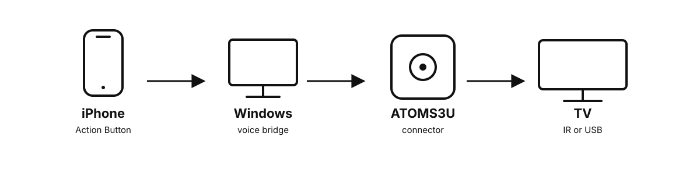

# Voice-Controlled TV with an iPhone Action Button

[](https://github.com/lukaschudy/atoms3u-tv-connector/actions/workflows/python-tests.yml)
[](https://github.com/lukaschudy/atoms3u-tv-connector/actions/workflows/atoms3u-firmware.yml)
[](LICENSE)

**Hold the iPhone Action Button, say what the TV should do, and release.** A
small [M5Stack ATOMS3U](https://docs.m5stack.com/en/core/AtomS3U) beside the TV
turns that request into infrared remote keys, USB keyboard input, or a controlled
combination of both.



```text
iPhone Action Button
  -> private Tailscale HTTPS
  -> lightweight Windows voice bridge
  -> signed local Wi-Fi command
  -> ATOMS3U
  -> infrared or USB HID
  -> TV
```

The Windows bridge runs quietly in the background; it is setup infrastructure,
not the remote-control interface. Normal use happens from the phone. No Raspberry
Pi or TV-vendor cloud API is required.

> **Project status:** experimental. Wi-Fi delivery, response authentication, and TV profiles are covered by host tests, simulation, and compile-only firmware builds. No physical ATOMS3U or television acceptance result is recorded for this release. Every TV model differs, so complete the compatibility checklist before relying on any key. See [Compatibility](docs/COMPATIBILITY.md).

## What you need

- An iPhone with a programmable Action Button
- Windows 11 computer that can remain signed in on the home network
- Tailscale installed on the iPhone and Windows computer
- M5Stack ATOMS3U
- USB-C data cable for flashing
- Python 3.11 or newer
- 2.4 GHz Wi-Fi reachable by the Windows bridge and ATOMS3U
- One supported output path:
  - the ATOMS3U built-in infrared emitter;
  - an optional [M5Stack Unit IR U002](https://docs.m5stack.com/en/unit/ir) for easier placement and longer range; or
  - a TV USB data port that accepts keyboard/media HID input

## Choose a TV profile

| Profile | Best for | Connection to TV | Current evidence |
|---|---|---|---|
| `lg-tv-ir-v1` | LG televisions | IR | Compiles and is protocol-tested; exact-model physical testing required |
| `sony-bravia-ir-v1` | Sony Bravia televisions | IR | Compiles and is protocol-tested; model testing required |
| `generic-usb-hid-v1` | TVs that accept a USB keyboard | USB data | Compiles and is protocol-tested; physical USB/TV acceptance pending |
| `lg-webos-hybrid-v1` | LG webOS with USB keyboard support | IR + USB data | Compiles and is simulated; physical acceptance pending |

The setup assistant explains these choices. Unsupported operations are rejected instead of being approximated with arbitrary automation.

The no-Mac path uses an Apple Shortcut with **Dictate Text**. The optional native
iPhone app currently requires a Mac with Xcode and local code signing; it is a
developer preview, not an App Store download.

## Quick start: Action Button to TV

### 1. Prepare the ATOMS3U on Windows

```powershell
git clone https://github.com/lukaschudy/atoms3u-tv-connector.git
cd atoms3u-tv-connector
powershell -ExecutionPolicy Bypass -File .\scripts\setup.ps1
```

The setup script creates an isolated Python environment, installs pinned PlatformIO tooling, asks for the TV profile and 2.4 GHz Wi-Fi credentials, and generates a unique authentication key. Passwords and keys are hidden, stored only in ignored local files, and never printed. The current firmware accepts printable ASCII Wi-Fi names and passwords; use a dedicated 2.4 GHz IoT network if your credentials require other characters.

Check the private configuration, connect the ATOMS3U directly with a USB-C data cable, and flash it:

```powershell
# Confirm that private settings and build tooling are ready
.\.venv\Scripts\python.exe room_agent\setup_tv_connector.py doctor

# Compile and upload; the built-in USB Serial/JTAG interface normally resets automatically
.\.venv\Scripts\python.exe room_agent\setup_tv_connector.py flash

# For the external Grove Unit IR U002 instead of the built-in side emitter
.\.venv\Scripts\python.exe room_agent\setup_tv_connector.py flash --emitter u002
```

No manual boot-button sequence is normally required. If upload cannot find the board, disconnect any USB hub, reconnect the data cable, press the recessed reset button once, and rerun the command. The large GPIO 41 user button is not the bootloader button. Cold-boot the board after flashing. The flashing serial port normally disappears because the production firmware becomes a USB keyboard/media device.

### 2. Verify the hardware and connect the voice bridge

The command-line remote is only a setup diagnostic. It discovers one matching
connector automatically and reuses the profile selected above:

```powershell
.\.venv\Scripts\python.exe room_agent\tv_remote.py status

# Start with a harmless command; test power last
.\.venv\Scripts\python.exe room_agent\tv_remote.py press MUTE

# Verify and save this connector for iPhone voice commands
.\.venv\Scripts\python.exe room_agent\setup_tv_connector.py connect-host
```

If discovery is blocked by a guest network or firewall, add
`--url http://192.168.1.50` before `status`, `press`, or `connect-host`. If several
connectors use the same profile, an explicit URL is required so the command
cannot reach the wrong TV.

Other allowlisted keys include `HOME`, `BACK`, `INPUT`, arrows, `ENTER`, `PLAY`, `PAUSE`, `VOLUME_UP`, and `VOLUME_DOWN`. Repeat a navigation or volume key with `--count 3` (maximum 20).

### 3. Install the background voice bridge

```powershell
powershell -ExecutionPolicy Bypass -File .\room_agent\install-windows-host.ps1
```

This installs one per-user background process, starts it, and verifies its local
health endpoint. It starts again whenever that Windows user signs in.

### 4. Program the iPhone Action Button

Follow the [Action Button guide](room_agent/IPHONE_WINDOWS.md). The recommended
public path needs no Mac: create the private Tailscale link, enroll the phone,
build the documented **Dictate Text** Shortcut, and select it under **Settings →
Action Button → Shortcut**.

Then hold the button and try:

1. **“Open YouTube.”**
2. **“Play Never Gonna Give You Up.”**
3. **“Pause.”**
4. **“Continue.”**
5. **“Google how much an elephant weighs.”**

The optional native app replaces the hand-built Shortcut with QR pairing, but it
currently requires Xcode. Both routes use the same private HTTPS endpoint and
the same bounded TV actions.

### Firmware-only setup on macOS or Linux

macOS and Linux can prepare and flash the ATOMS3U, but the supported Action
Button voice bridge is currently Windows-only:

```bash
git clone https://github.com/lukaschudy/atoms3u-tv-connector.git
cd atoms3u-tv-connector
chmod +x scripts/setup.sh
./scripts/setup.sh
```

Replace `.\.venv\Scripts\python.exe` in firmware commands with
`.venv/bin/python`.

## Built-in emitter placement

For LG testing, infrared exits through the tiny opening on the **long side beside the white Grove socket**. Aim that opening at the TV's lower-bezel receiver. The blunt end opposite USB is not the emitter. IR requires line of sight or a reliable reflection path.

The external U002 connects to the white Grove socket and uses GPIO 2 for IR transmit. Disconnect power before attaching or removing it. See the [firmware guide](room_agent/firmware/atoms3u_tv_connector/README.md) for the pin map and acceptance sequence.

## How it stays bounded

- HMAC-SHA256 authenticates every command and every successful execution response with a per-device 256-bit key.
- A 30-second timestamp window, nonce cache, and signed per-boot identifier reject stale, same-boot, and cross-reboot replays.
- Firmware accepts only typed `key`, printable ASCII `text`, and bounded `wait` steps.
- Requests are limited to 32 steps, 120 text characters, and 20 seconds of waits.
- The connector cannot run shell commands, arbitrary code, or caller-provided URLs.
- The selected firmware profile rejects keys it does not support.

The HTTP control endpoint is for a trusted local network and is not encrypted. Never expose it directly to the internet. Health and discovery metadata—including profile, IP address, readiness, and the last emitted IR key—are visible to devices on that network. Read [SECURITY.md](SECURITY.md) before deploying it on a shared network.

## Develop without hardware

The simulator uses the same authentication, schema, profile validation, and HTTP client as the real connector:

```powershell
.\.venv\Scripts\python.exe room_agent\configure_connector.py init --key-file room_agent\tv-connector.key
.\.venv\Scripts\python.exe room_agent\connector_simulator.py --key-file room_agent\tv-connector.key --profile lg-tv-ir-v1
```

In another terminal:

```powershell
.\.venv\Scripts\python.exe room_agent\tv_remote.py --url http://127.0.0.1:8780 --key-file room_agent\tv-connector.key --profile lg-tv-ir-v1 status
.\.venv\Scripts\python.exe room_agent\tv_remote.py --url http://127.0.0.1:8780 --key-file room_agent\tv-connector.key --profile lg-tv-ir-v1 press VOLUME_UP --count 2
```

On macOS/Linux, replace `.\.venv\Scripts\python.exe` with `.venv/bin/python`
and use forward slashes in paths.

Run host-side tests with:

```bash
# Windows PowerShell:
.\.venv\Scripts\python.exe -m unittest discover -s room_agent -v
# Linux/macOS:
.venv/bin/python -m unittest discover -s room_agent -v
```

CI firmware artifacts are compiled only with placeholder Wi-Fi settings and a
zero authentication key; they are not installable production firmware. Prepare
and flash a unique local build for each connector. Never publish a binary built
from `include/secrets.h`.

## Repository map

| Path | Purpose |
|---|---|
| [`room_agent/firmware/atoms3u_tv_connector/`](room_agent/firmware/atoms3u_tv_connector/) | Production and diagnostic ATOMS3U firmware |
| [`room_agent/setup_tv_connector.py`](room_agent/setup_tv_connector.py) | Safe preparation, diagnostics, build, and flashing assistant |
| [`room_agent/tv_remote.py`](room_agent/tv_remote.py) | Setup-only authenticated diagnostic remote |
| [`room_agent/configure_connector.py`](room_agent/configure_connector.py) | Lower-level provisioning and host enrollment commands |
| [`room_agent/connector_simulator.py`](room_agent/connector_simulator.py) | Hardware-free protocol simulator |
| [`room_agent/tv_connector.py`](room_agent/tv_connector.py) | Typed protocol and host client |
| [`docs/COMPATIBILITY.md`](docs/COMPATIBILITY.md) | Honest TV/profile compatibility matrix and test template |
| [`docs/TROUBLESHOOTING.md`](docs/TROUBLESHOOTING.md) | Setup, flashing, Wi-Fi, USB, and IR diagnosis |
| [`room_agent/IPHONE_WINDOWS.md`](room_agent/IPHONE_WINDOWS.md) | iPhone Action Button and Windows voice-bridge setup |
| [`room_agent/README.md`](room_agent/README.md) | Advanced Raspberry Pi and smart-TV integrations |

## Optional full room assistant

This repository began as a broader local-first room voice agent. Raspberry Pi
speech recognition, HDMI playback, and native smart-TV adapters remain as
advanced examples, but they are **not required** for the iPhone Action Button
route above.

## Contributing

Hardware reports are especially useful. Include the exact TV model, selected profile/emitter, firmware revision, and which keys were visibly confirmed. Clearly label results as compiled, simulated, or physically validated.

See [CONTRIBUTING.md](CONTRIBUTING.md), [CODE_OF_CONDUCT.md](CODE_OF_CONDUCT.md), and [SECURITY.md](SECURITY.md). The project is available under the [Apache License 2.0](LICENSE).

Maintainers preparing a visibility change or first tagged release should follow
the [public release checklist](docs/PUBLIC_RELEASE_CHECKLIST.md).
